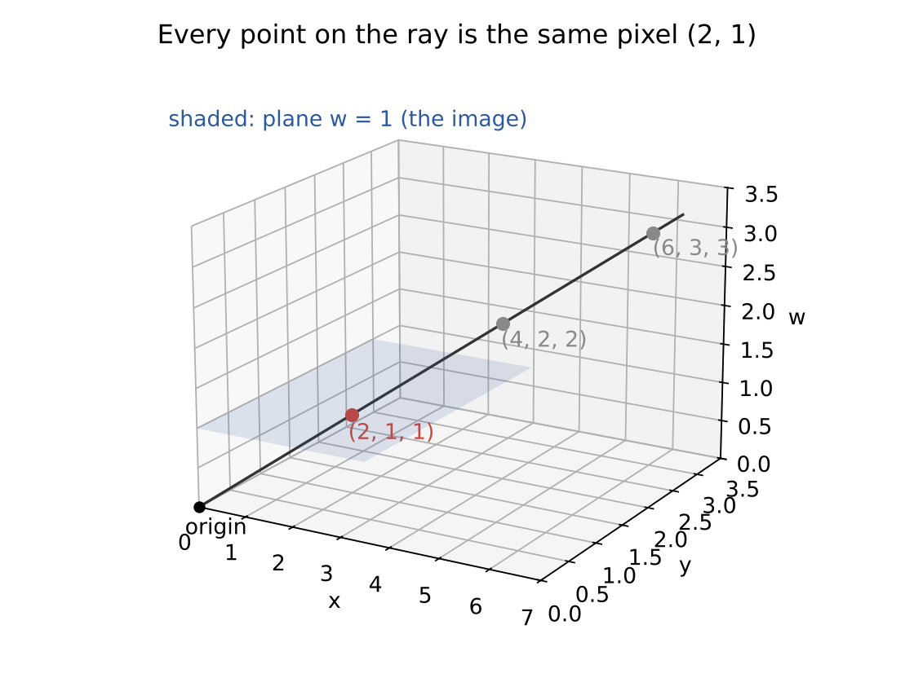
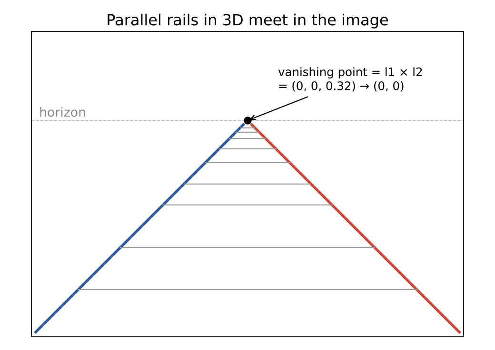



*Foundations of 3D Vision, Part 2 of 7. Previous: [Part 1, the pinhole camera](/posts/pinhole-camera/).*

In [Part 1](/posts/pinhole-camera/) we found that a 3D point $(X, Y, Z)$ lands on the image at

$$
x = f\,\frac{X}{Z}, \qquad y = f\,\frac{Y}{Z}
$$

That division by $Z$ is the whole story of perspective. It is also a nuisance. Linear algebra is built for multiplying matrices, and dividing by one of your own coordinates is not a matrix operation. Neither, it turns out, is moving a point sideways.

Homogeneous coordinates fix both problems with one trick: write every point with one extra number, usually a 1. This post explains why that works, and why you will see it in nearly every vision paper and codebase.

## Two things matrices can't do

A matrix can rotate, scale and shear a point. It always maps the origin to the origin, though, so it cannot **translate**. Moving a 2D point by $(t_x, t_y)$ is

$$
\begin{bmatrix} x' \\ y' \end{bmatrix} = \begin{bmatrix} x \\ y \end{bmatrix} + \begin{bmatrix} t_x \\ t_y \end{bmatrix}
$$

an addition, not a multiplication. And a matrix cannot **divide by $Z$**, so it cannot project.

A real camera needs both: the world has to be rotated and translated into the camera's frame, then projected. Without a fix, every camera pipeline is a messy mix of matrix products, additions and divisions that do not chain together.

## The trick: add a 1

Write the 2D point $(x, y)$ as the 3-vector $(x, y, 1)$. Now translation is a matrix:

$$
\begin{bmatrix} x + t_x \\ y + t_y \\ 1 \end{bmatrix} =
\begin{bmatrix} 1 & 0 & t_x \\ 0 & 1 & t_y \\ 0 & 0 & 1 \end{bmatrix}
\begin{bmatrix} x \\ y \\ 1 \end{bmatrix}
$$

The last column multiplies the 1 and adds the shift. The same works in 3D with a $4 \times 4$ matrix and points written as $(X, Y, Z, 1)$.

## The rule that makes it work: scale doesn't matter

Here is the part that takes getting used to. In homogeneous coordinates, **any nonzero multiple of a vector is the same point**:

$$
(x, y, 1) \;\sim\; (2x, 2y, 2) \;\sim\; (wx, wy, w)
$$

To get back to ordinary coordinates, divide by the last entry and drop it: $(a, b, w) \to (a/w,\; b/w)$.



Geometrically, a 2D point is a whole ray through the origin of 3D space, and the ordinary point is where that ray crosses the plane $w = 1$. If that sounds familiar, it should. In Part 1, every 3D point along a ray through the pinhole gave the same pixel. Homogeneous coordinates take that fact and make it the definition.

## Projection becomes a matrix

Because scale doesn't matter, we can let a matrix do everything except the final division, and leave the division to the "drop the last entry" step:

$$
\begin{bmatrix} fX \\ fY \\ Z \end{bmatrix} =
\begin{bmatrix} f & 0 & 0 & 0 \\ 0 & f & 0 & 0 \\ 0 & 0 & 1 & 0 \end{bmatrix}
\begin{bmatrix} X \\ Y \\ Z \\ 1 \end{bmatrix}
$$

Divide by the last entry and you get $(fX/Z,\; fY/Z)$, exactly the pinhole equation. The $3 \times 4$ matrix is a first version of the **camera matrix**. Since translation and rotation are now matrices too, a whole camera becomes one product of matrices, applied in one step, with one division at the very end.

## A bonus: points at infinity

What about $w = 0$? The vector $(x, y, 0)$ has no ordinary point: you can't divide by zero. It is a **point at infinity**, a pure direction.

That turns out to be useful:

- **Directions ignore translation.** Multiply $(1, 1, 0)$ by the translation matrix above and you get $(1, 1, 0)$ back. Shifting a scene moves its points, not its directions, and the math now says so for free.
- **Parallel lines meet.** In homogeneous coordinates, parallel lines meet at a point at infinity. After a camera projects them, that point can land inside the image as a **vanishing point**.

## Lines, for free

A 2D line $ax + by + c = 0$ can be written as the vector $\ell = (a, b, c)$. A point $p = (x, y, 1)$ lies on it exactly when

$$
\ell \cdot p = 0
$$

Two neat results follow from the cross product:

- The line through two points is $\ell = p_1 \times p_2$.
- The point where two lines meet is $p = \ell_1 \times \ell_2$.

No special cases, no solving equations by hand, no worrying about vertical lines with infinite slope. If the lines are parallel, the cross product simply comes out with $w = 0$.



## Try it: the camera as a matrix

Here is the same cube from Part 1, projected with a matrix instead of a hand-written division, and checked against the Part 1 answer.

```python
import numpy as np

def to_h(p):
    """Append a 1: (N, d) -> (N, d+1)."""
    return np.hstack([p, np.ones((len(p), 1))])

def from_h(p):
    """Divide by the last coordinate and drop it."""
    return p[:, :-1] / p[:, -1:]

f = 1.0
P = np.array([[f, 0, 0, 0],
              [0, f, 0, 0],
              [0, 0, 1, 0]])

corners = np.array([[x, y, z] for x in (0, 1) for y in (0, 1) for z in (0, 1)], float)
near = corners - 0.5 + np.array([-1.0, 0.0, 4.0])

pixels = from_h(to_h(near) @ P.T)
print(np.allclose(pixels, f * near[:, :2] / near[:, 2:]))   # True
```

And a vanishing point in three lines. Take two parallel rails on the ground ($X = \pm 1$, $Y = -1$), project two points along each at depths 2 and 10, and intersect the image lines:

```python
left  = [np.array([-1/z, -1/z, 1]) for z in (2, 10)]
right = [np.array([ 1/z, -1/z, 1]) for z in (2, 10)]

l1 = np.cross(*left)     # line through the left rail's two image points
l2 = np.cross(*right)
v  = np.cross(l1, l2)    # where they meet
print(v, v[:2] / v[2])   # [0. 0. 0.32] -> (0, 0), the image center
```

The rails never meet in 3D, but in the image they meet at the center: the vanishing point for a camera looking straight down the track.

## Pitfalls

- **Forgetting to divide.** A homogeneous vector is not a pixel until you divide by its last entry. Many bugs are a missing `from_h`.
- **Comparing without normalizing.** $(2, 4, 2)$ and $(1, 2, 1)$ are the same point. Check equality after dividing, or with a cross product near zero.
- **Dividing by a tiny $w$.** Points near infinity, or behind the camera ($w < 0$ in the projection above), need care. Clip or flag them before dividing.

## Where this shows up

Every camera matrix, homography, fundamental matrix and 3D transform you will meet is written in homogeneous coordinates. Graphics uses the same trick: the $4 \times 4$ matrices in OpenGL and every game engine are homogeneous transforms. In my own inverse-rendering work, every ray cast from a pixel starts as a homogeneous point pushed back through the camera matrix.

So far the camera matrix is a toy: it assumes the camera sits at the origin, pixels are measured from the image center, and both axes use the same units. Real cameras need two matrices: one for the camera's own lens and sensor, one for where it sits in the world.

**Next, Part 3: intrinsics and extrinsics, the camera matrix piece by piece.**

## Further reading

- Richard Hartley and Andrew Zisserman, *Multiple View Geometry in Computer Vision*, Chapter 2 (projective geometry of the plane).
- Richard Szeliski, *Computer Vision: Algorithms and Applications*, Section 2.1 (free online at [szeliski.org/Book](https://szeliski.org/Book/)).
