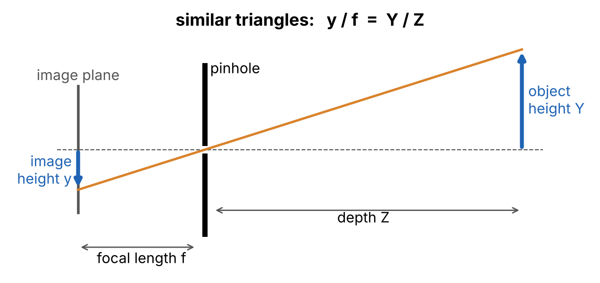
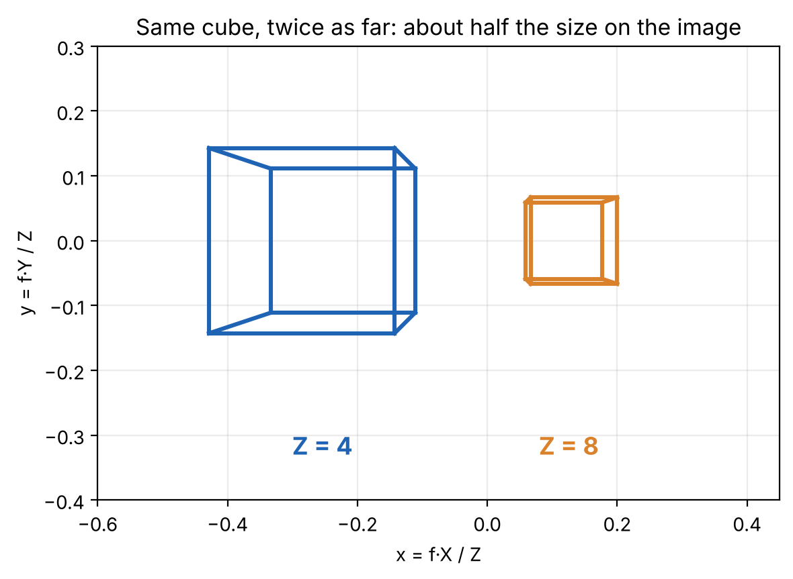



*Foundations of 3D Vision, Part 1 of 7.*

Every photo you have ever taken threw away one dimension. The world is 3D, the image is 2D, and somewhere between the lens and the sensor, depth disappeared.

Almost everything in 3D vision, from stereo to structure-from-motion to NeRF and Gaussian splatting, is an attempt to get that dimension back. To do that, you first need to know exactly how it was lost. That is what the pinhole camera model tells you.

## The idea: a tiny hole

Put a box in front of a bright scene and poke a tiny hole in the front. Light from each point in the scene travels in a straight line, through the hole, and lands on the back wall. The result is a sharp, upside-down image of the scene. This is the *camera obscura*, known for over two thousand years.

Because the hole is tiny, each point on the back wall receives light from exactly one direction. That one-ray-per-pixel idea is the whole model. Real cameras use lenses to gather more light, but geometrically they behave like a pinhole, which is why this model sits under nearly every algorithm in the field.

## The geometry: similar triangles



Place the pinhole at the origin and let the camera look along the Z axis. A point on an object sits at height $Y$ and depth $Z$. The image plane sits a distance $f$ behind the hole; $f$ is the **focal length**.

The ray from the point through the hole forms two similar triangles: one in front of the hole, one behind it. Their sides are proportional:

$$
\frac{y}{f} = \frac{Y}{Z}
$$

The same holds sideways, so a 3D point $(X, Y, Z)$ lands on the image at

$$
x = f\,\frac{X}{Z}, \qquad y = f\,\frac{Y}{Z}
$$

The real image is upside down, which would add a minus sign. Vision papers almost always imagine the image plane *in front* of the hole instead, at distance $f$, where the image is upright and the minus sign goes away. Same geometry, easier bookkeeping. That is the convention used from here on.

## What the equation tells you

Two things fall straight out of the division by $Z$.

**Farther things look smaller.** Double the depth and the image halves. This is perspective, and it is why railway tracks seem to meet at the horizon.

**Depth is gone.** Take any point and slide it along its ray: $(2X, 2Y, 2Z)$, $(10X, 10Y, 10Z)$. Every one of them gives the same $(x, y)$, because the factor cancels in $X/Z$ and $Y/Z$. A single pixel tells you the *direction* of a point, never its distance. A small toy car close up and a real car far away can produce exactly the same photo.

That second point is the central problem of 3D vision. Every method for recovering depth adds information the single image lacks: a second view (stereo), many views (structure-from-motion, NeRF), motion, or learned priors about what shapes are likely.

## Try it: fifteen lines of NumPy

Here is the model in code. It projects the same cube placed at two depths.

```python
import numpy as np

def project(points, f=1.0):
    """Pinhole projection: (X, Y, Z) -> (f*X/Z, f*Y/Z)."""
    X, Y, Z = points[:, 0], points[:, 1], points[:, 2]
    return np.stack([f * X / Z, f * Y / Z], axis=1)

# A unit cube: 8 corners, 12 edges
corners = np.array([[x, y, z] for x in (0, 1) for y in (0, 1) for z in (0, 1)], float)
edges = [(i, j) for i in range(8) for j in range(i + 1, 8)
         if np.sum(np.abs(corners[i] - corners[j])) == 1]

def place(cube, offset):
    return cube - 0.5 + np.array(offset)  # center it, then move it

near = place(corners, [-1.0, 0.0, 4.0])   # 4 units from the camera
far  = place(corners, [ 1.0, 0.0, 8.0])   # same cube, twice as far
```

Draw each edge of `project(near)` and `project(far)` with matplotlib and you get this:



Two things to notice. The far cube is about half the size, as $1/Z$ predicts. And in the near cube the front face looks bigger than the back face, even though they are the same size in 3D: the front is closer. That difference in size across one object is what gives a photo its sense of depth.

## Where this shows up

This one equation is inside almost everything:

- **Camera calibration** estimates $f$ and a few related numbers for a real camera.
- **Stereo and structure-from-motion** use two or more of these projections to triangulate depth.
- **NeRF and Gaussian splatting** render images by casting exactly these rays, one per pixel.
- **Inverse rendering**, the area of my own Ph.D. work, runs the projection backwards to recover shape, color and lighting from photos.

The model so far assumes the camera sits at the origin, looks straight down Z, and measures the image in the same units as the world. Real cameras do none of that. Fixing it cleanly needs one trick: an extra coordinate that turns the division into a matrix multiplication.

**Next, Part 2: homogeneous coordinates, or why vision adds an extra 1.**

## Further reading

- Richard Hartley and Andrew Zisserman, *Multiple View Geometry in Computer Vision*, Chapter 6.
- Richard Szeliski, *Computer Vision: Algorithms and Applications*, Section 2.1 (free online at [szeliski.org/Book](https://szeliski.org/Book/)).
