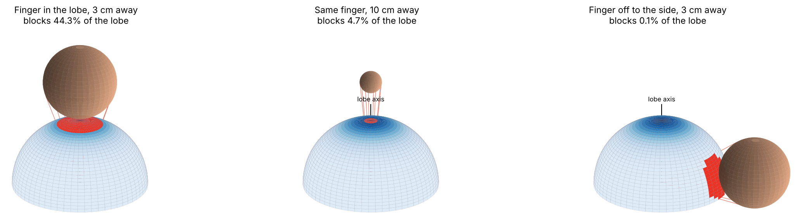



Pick up a mug and look at it. Your fingers cast small shadows on it, and the side facing your palm picks up a faint warm tint from your skin. You don't notice either, because your brain separates "the mug's color" from "how the mug is lit right now."

A 3D reconstruction method doesn't make that separation for free. Give it a video of a hand turning an object, and it will often produce a texture with dark finger-shaped smudges and a skin-colored cast painted into it. The shadow becomes part of the object.

[TexHOI](/research/texhoi/) is my paper on fixing this, with Ningna Wang and Xiaohu Guo at UT Dallas. It was published in IEEE TVCG (CVM 2025), where it won the Best Paper Award. This post explains the problem and the idea, without the full paper's detail.

## Color vs appearance

What a camera records at a pixel is not the object's color. It is the object's color *after* lighting has been applied. The rendering equation makes this explicit (I wrote about it [here](/posts/sg-render/)):

$$
R(o) = \int_{S^2} L(i)\, V(i)\, \rho_o(i)\, \max(0, i \cdot n)\, di
$$

The quantity we want is the **albedo**, inside the BRDF $\rho_o$: the color the surface would have under perfectly even white light. Everything else in the integral is about the scene. $L(i)$ is how much light arrives from direction $i$, and $V(i)$ says whether that direction is blocked.

Recovering albedo from photos is called *inverse rendering*: you fit the albedo, the lighting and the visibility so that rendering them reproduces the images. If you get the lighting or the visibility wrong, the error has to go somewhere, and it goes into the albedo.

## What the hand changes

In hand-object video the hand breaks two of the usual assumptions.

**The hand blocks light.** $V(i)$ is no longer only about the object shadowing itself. Fingers block parts of the sky for each point on the surface, and they move every frame.

**The hand adds light.** Skin reflects light back onto the object. That is extra *indirect* illumination, tinted by skin color, that a model of the environment light alone can't explain.

There is also a third problem upstream: the hand hides parts of the object, so the object's pose in each frame is harder to estimate. A texture fitted with slightly wrong poses comes out blurry, however good the lighting model is.

## The idea: model the hand, then subtract it

TexHOI works in two stages.

**Stage 1: get the geometry and poses right.** Three neural radiance fields model the hand, the object and the background, and their outputs are composited along each camera ray. The hand and object poses are optimized jointly with the fields. This stage gives the object's shape, accurate per-frame poses, and a mask showing where the object is actually visible.

**Stage 2: separate color from lighting.** With geometry fixed, the method switches to physics-based rendering:

- **Environment light** is a mixture of 128 spherical Gaussians (see [this post](/posts/sg/) for what those are).
- **Material** is a small network predicting albedo and roughness at each surface point.
- **Hand visibility** is the key part. The hand is approximated by 108 spheres attached to a parametric hand model, so they move and resize with the hand's pose and shape. At each point on the object, every lighting lobe is divided into a 64×64 grid of patches, and each sphere is projected onto that grid. The blocked fraction of the lobe is the integral over the covered patches, computed in closed form with the spherical Gaussian approximation from Iwasaki et al. No ray tracing is needed.
- **Skin bounce** is a learned indirect-light term, initialized to a skin tone. Where the hand blocks a lobe, the blocked light is replaced by this skin-colored light.

Because the shadows and the skin tint are now explained by the hand, the optimizer no longer needs to paint them into the albedo.

## A toy version: projecting a sphere onto a lobe

Spheres are a good choice because projecting one onto a lobe has an exact answer. Seen from a surface point, a sphere of radius $r$ whose center is distance $d$ away covers a cap of directions with angular radius $\arcsin(r/d)$. A patch of the lobe is blocked if its direction falls inside that cap.

A spherical Gaussian lobe with axis $p$ and sharpness $\lambda$ has strength $e^{\lambda(\cos\theta - 1)}$ at angle $\theta$ from its axis. Measuring $\theta$ and $\phi$ around the lobe axis, its integral over one patch has a closed form:

$$
\int_{\phi_0}^{\phi_1}\!\int_{\theta_0}^{\theta_1} e^{\lambda(\cos\theta - 1)} \sin\theta \, d\theta\, d\phi
= (\phi_1 - \phi_0)\,\frac{e^{\lambda(\cos\theta_0 - 1)} - e^{\lambda(\cos\theta_1 - 1)}}{\lambda}
$$

So the whole computation is: split the lobe into patches, project the sphere, and add up the covered patches.

```python
import numpy as np

def frame(axis):
    """Two unit vectors perpendicular to the lobe axis."""
    a = np.array([1.0, 0, 0]) if abs(axis[0]) < 0.9 else np.array([0, 1.0, 0])
    t = np.cross(axis, a); t /= np.linalg.norm(t)
    return t, np.cross(axis, t)

def occluded_fraction(x, axis, sharpness, centers, radii, n=64):
    """Project hand spheres onto an SG lobe at point x; return the fraction of the lobe they block."""
    t, b = frame(axis)
    theta = np.linspace(0, np.pi, n + 1)          # angle from the lobe axis
    phi = np.linspace(0, 2 * np.pi, n + 1)        # angle around it

    # Exact SG integral over each patch (the formula above)
    ring = np.exp(sharpness * (np.cos(theta) - 1)) / sharpness
    weight = np.outer(ring[:-1] - ring[1:], np.diff(phi))   # n x n patch integrals

    # Direction at each patch centre
    tc, pc = (theta[:-1] + theta[1:]) / 2, (phi[:-1] + phi[1:]) / 2
    T, P = np.meshgrid(tc, pc, indexing="ij")
    dirs = (np.cos(T)[..., None] * axis
            + (np.sin(T) * np.cos(P))[..., None] * t
            + (np.sin(T) * np.sin(P))[..., None] * b)

    # Project each sphere onto the lobe: it covers a cap of angular radius asin(r / d)
    covered = np.zeros((n, n), dtype=bool)
    for c, r in zip(centers, radii):
        to_c = c - x
        d = np.linalg.norm(to_c)
        covered |= dirs @ (to_c / d) > np.sqrt(max(0.0, 1 - (r / d) ** 2))

    return weight[covered].sum() / weight.sum()

x = np.zeros(3)                                    # a point on the object
axis, sharpness = np.array([0, 0, 1.0]), 10.0      # one lighting lobe, pointing straight up
finger = 0.01                                      # a 1 cm fingertip sphere
print(occluded_fraction(x, axis, sharpness, [np.array([0, 0, 0.03])], [finger]))     # 0.443
print(occluded_fraction(x, axis, sharpness, [np.array([0, 0, 0.10])], [finger]))     # 0.047
print(occluded_fraction(x, axis, sharpness, [np.array([0.03, 0, 0.01])], [finger]))  # 0.001
```



Three things show up. A fingertip 3 cm away, in the lobe's direction, blocks 44% of that lobe. Move it to 10 cm and it blocks under 5%, because its cap shrinks. Move it off to the side and it covers patches where the lobe is nearly zero, so it blocks almost nothing even though it's just as close. That is why hand shadows are strongest where fingers touch the object, and why they depend on where the light comes from.

The blocked fraction then decides how the point is lit. Blocked environment light is replaced by the hand's skin-colored light:

$$
L = L_{\text{env}}\,(1 - F) + L_{\text{skin}}\,F
$$

TexHOI does this for all 108 spheres and all 128 lobes, at every surface point, in every frame.

## Results

On six textured objects from the HO3D dataset, TexHOI was compared with HOLD and with InvRender, measured against ground-truth textures:

| Method | PSNR ↑ | SSIM ↑ | LPIPS ↓ |
|---|---|---|---|
| InvRender | 19.23 | 0.9301 | 0.154 |
| HOLD | 20.61 | 0.9354 | 0.101 |
| **TexHOI** | **20.96** | **0.9387** | **0.095** |

The averages are best on all three metrics, but not every object wins. HOLD scores a higher PSNR on three of the six objects. Pixel metrics partly reward a texture that matches the images, shadows included, so the visual comparison tells the story better:



Once color and lighting are separated, the object can be relit under a new environment, which you can't do with a texture that has shadows painted in:



## Limitations

- If the hand never moves relative to the object, its imprint still gets baked in. The method needs the hand to shift so it can tell shadow from surface.
- Spheres near the fingertips can slightly penetrate the object, which causes small errors in the occlusion.
- It handles a single right hand, and the two stages are optimized separately, not jointly.
- Skin bounce is a single learned term, not a full model of skin reflectance.

## Why it matters

Hand-held capture is how most people would naturally scan an object: pick it up and turn it in front of a phone. If reconstruction can't handle the hand, you either need a turntable or you get a texture with fingers in it. TexHOI was, as far as we know, the first method to account for hand-object interaction in object texture reconstruction.

This research can be further used with Gaussian splats. Along with inpainting methods (including diffusion-based inpainting), the geometric shape can be extracted even in scenarios of heavy hand occlusion on the object.

## Links

- Paper: [arXiv 2501.03525](https://arxiv.org/abs/2501.03525) · [IEEE TVCG](https://doi.org/10.1109/TVCG.2025.3567276)
- Code: [github.com/alakhag/TexHOI](https://github.com/alakhag/TexHOI)
- Talk: [YouTube](https://youtu.be/G6iyfrgBCbI)
- Background on this blog: [Spherical Gaussians](/posts/sg/) and [rendering with them](/posts/sg-render/)

*Previously: [The pinhole camera](/posts/pinhole-camera/). Next week: Foundations of 3D Vision, Part 2: homogeneous coordinates.*
